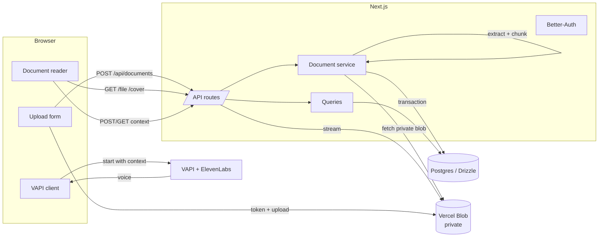

# Docify

[](https://github.com/xshubhamg/docify/actions/workflows/ci.yml)
[](./LICENSE)

**Voice-first document intelligence.** Upload a PDF, pick a voice, and hold a live
conversation grounded in the document's text — with the source and transcript side
by side.

> Docify is an independent project in active development. It supports **PDFs** and
> **keyword-grounded** voice Q&A. It does not claim Word, OCR, or semantic-RAG
> support.

---

## Why it exists

Reading a 300-page report to answer one question is a bad use of attention. Docify
lets you ask out loud and hear an answer that is grounded in the actual pages, while
the reader stays open so you can verify the source yourself.

## Features

- **Private PDF ingestion** — server-side extraction, 180-word chunks with 30-word
  overlap, stored transactionally.
- **Live voice conversations** — VAPI turn-taking with ElevenLabs voice personas.
- **Document grounding** — the assistant receives an overview of the most relevant
  segments before the call starts; a context failure never blocks the call.
- **Source reader** — page navigation, active-page tracking, and segment previews.
- **Live transcript** — assistant and user turns stream into the voice panel.
- **Session history** — start/end timestamps and duration per document.
- **Private by default** — Vercel Blob with `access: "private"`; files are streamed
  through authenticated proxy routes, never exposed as raw URLs.
- **Better-Auth** — email/password and Google OAuth.
- **Catppuccin design system** — Latte and Mocha themes with a shared token set.

## Architecture



**Request lifecycle (upload → voice):**

1. The client requests a scoped upload token from `/api/blob/upload`, uploads the PDF
   and optional cover directly to private Blob storage, then calls
   `POST /api/documents`.
2. The service verifies ownership and blob metadata, re-checks PDF constraints,
   extracts text with `pdfjs-dist/legacy`, chunks it, and inserts the document and
   segments in a transaction. Any failure deletes the uploaded blobs.
3. The reader fetches metadata and segments from the server, renders the PDF through
   authenticated proxy routes, and starts a voice session.
4. Before `vapi.start`, the client fetches `/context?limit=5` and passes the overview
   as `variableValues` alongside the ElevenLabs voice override.

## Tech stack

| Layer                     | Choice                                        |
| ------------------------- | --------------------------------------------- |
| Runtime / package manager | Bun                                           |
| Framework                 | Next.js 16 (App Router), React 19             |
| Language                  | TypeScript (strict)                           |
| Styling                   | Tailwind CSS v4, shadcn/ui, Catppuccin tokens |
| Database                  | PostgreSQL + Drizzle ORM                      |
| Auth                      | Better-Auth (email/password + Google OAuth)   |
| Storage                   | Vercel Blob (private)                         |
| Voice                     | VAPI + ElevenLabs                             |
| PDF                       | `pdfjs-dist` (server), `react-pdf` (client)   |

## Getting started

### Prerequisites

- Bun
- PostgreSQL (Neon, Supabase, or local)
- Vercel Blob token
- VAPI public key + assistant ID
- Google OAuth credentials (optional)

### Setup

```bash
git clone https://github.com/xshubhamg/docify.git
cd docify
bun install
cp .env.example .env.local
```

Fill in `.env.local`:

| Variable                      | Required    | Notes                          |
| ----------------------------- | ----------- | ------------------------------ |
| `DATABASE_URL`                | yes         | Postgres connection string     |
| `BETTER_AUTH_SECRET`          | yes         | `openssl rand -base64 32`      |
| `BETTER_AUTH_URL`             | yes         | `http://localhost:3000` in dev |
| `BLOB_READ_WRITE_TOKEN`       | yes         | Vercel → Storage → Blob        |
| `GOOGLE_CLIENT_ID`            | for OAuth   | Google Cloud console           |
| `GOOGLE_CLIENT_SECRET`        | for OAuth   | Google Cloud console           |
| `NEXT_PUBLIC_VAPI_PUBLIC_KEY` | for voice   | VAPI dashboard → API keys      |
| `NEXT_PUBLIC_ASSISTANT_ID`    | for voice   | VAPI dashboard → Assistants    |
| `UPSTASH_REDIS_REST_URL`      | recommended | Shared rate limiting           |
| `UPSTASH_REDIS_REST_TOKEN`    | recommended | Shared rate limiting           |

Run the database migrations and start the app:

```bash
bun db:migrate
bun dev
```

Open <http://localhost:3000>.

Without VAPI keys the reader still works; the voice panel explains what is missing.

## Scripts

| Command                 | Purpose                     |
| ----------------------- | --------------------------- |
| `bun dev`               | Development server          |
| `bun run build`         | Production build            |
| `bun start`             | Serve the production build  |
| `bun run lint`          | ESLint                      |
| `bun run typecheck`     | TypeScript, no emit         |
| `bun run format`        | Prettier                    |
| `bun run check`         | Lint + typecheck + tests    |
| `bun run test`          | Unit tests (Vitest)         |
| `bun run test:coverage` | Tests + coverage thresholds |
| `bun db:generate`       | Generate Drizzle migrations |
| `bun db:migrate`        | Apply migrations            |
| `bun db:push`           | Push schema (dev only)      |
| `bun db:studio`         | Drizzle Studio              |

## Project structure

```
src/
├── app/
│   ├── (landing)/          # Public hero, pricing, terms, privacy
│   ├── (auth)/             # Login and signup
│   ├── (main)/             # Dashboard, upload, reader, settings
│   └── api/                # Auth, blob, documents, voice sessions, context
├── components/
│   ├── documents/          # Reader and its client-only wrapper
│   └── ui/                 # shadcn primitives
└── lib/
    ├── db/                 # Drizzle client and schema
    └── documents/          # Service, queries, PDF, storage, errors, types
```

Domain rules live in `lib/documents`; route handlers stay thin. See `AGENTS.md` for
the full contract and `plan.md` for the roadmap.

## Security model

- Every document query is scoped by `userId`; foreign slugs return `404`.
- Blobs are private and streamed through authenticated routes.
- Upload tokens are prefix-scoped per user and expire after five minutes.
- Inputs are validated with Zod at the API boundary.
- Secrets are never committed; `.env*` is ignored except `.env.example`.

See [`SECURITY.md`](./SECURITY.md) for reporting and details.

## Roadmap

See [`plan.md`](./plan.md). Near-term work: tests and CI, rate limiting, environment
validation, reader virtualization, Postgres full-text search, accessibility, and a
mid-call `search_document` tool.

## Contributing

See [`CONTRIBUTING.md`](./CONTRIBUTING.md). Commits follow Conventional Commits and
are enforced by Husky + commitlint.

## License

[MIT](./LICENSE)
